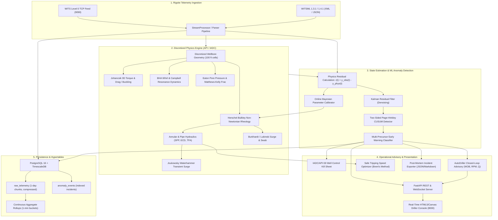

# Rig Digital Twin Core - Architecture Overview

`rig-digital-twin-core` is an industrial-grade, real-time wellbore simulation engine designed for autonomous and advisory drilling operations. The architecture is built around decoupled layers separating data ingestion, deterministic petroleum physics, machine learning state estimators, operational advisory controllers, and high-performance time-series persistence.

---

## 1. System Architecture Diagram

---

## 2. Decoupled Architectural Layers

### Layer 1: Ingestion & Telemetry Normalization (`rig_twin.ingestion`)
- **`wits0_parser.py`**: High-throughput asynchronous TCP server decoding WITS Level 0 packets (Record Type 01, general drilling) with bi-directional encoder support.
- **`witsml_parser.py`**: Robust parser handling both hierarchical XML schemas (WITSML 1.3.1, 1.4.1) and JSON envelopes, standardizing telemetry into unified `TelemetryRecord` models.
- **`stream_processor.py`**: Continuous async stream orchestrator linking incoming rig sensors to the physics engine, statistical estimators, and persistence queue.

### Layer 2: Deterministic Petroleum Physics Engine (`rig_twin.physics`)
Discretizes the entire wellbore from surface to Total Depth (TD) into spatial intervals (typically $\Delta L = 100\text{ ft}$) and executes deterministic formulations:
- **`rheology.py`**: Herschel-Bulkley ($n$, $K$, $\tau_0$), Bingham Plastic, and Power-Law models with API RP 13D golden-section search regression.
- **`hydraulics.py`**: Discretized drillstring bore, annular frictional pressure losses, bit nozzle jet impact velocity, and Equivalent Circulating Density ($ECD$).
- **`torque_drag.py`**: 3D Johancsik soft-string tension/torque integration, normal contact loads, Dawson-Paslay sinusoidal buckling, and Lubinski helical buckling limits.
- **`vibrations.py`**: 3-axis BHA drillstring dynamics, torsional stick-slip severity, lateral/axial whirl frequencies, and Campbell diagram critical RPM avoidance windows.
- **`transient_hydraulics.py`**: Joukowsky acoustic wave transient surge calculation during sudden valve closures or pump trips.
- **`geopressure.py`**: Dynamic Eaton pore pressure prediction from corrected $d_{xc}$ exponents and Matthews-Kelly fracture gradient envelopes.
- **`well_control_kill_sheet.py`**: Automated IADC / API-59 Kill Sheet generator computing Kill Mud Weight ($KMW$), Initial Circulating Pressure ($ICP$), Final Circulating Pressure ($FCP$), MAASP, and step-down schedules.

### Layer 3: Machine Learning & State Estimation (`rig_twin.ml`)
- **`estimator.py`**: Isolates physical sensor residuals $r_t = y_{\text{obs},t} - y_{\text{phys},t}$, denoises through a 1D recursive Kalman filter, and monitors cumulative deviations with two-sided Page-Hinkley CUSUM algorithms.
- **`kick_detector.py`**: Real-time multi-signature classifier distinguishing kick precursors, swab underbalance, pack-offs, and washouts with early severity scoring.
- **`auto_calibrator.py`**: Bayesian online parameter updater tuning downhole friction factors and rheological yield stresses against clean steady-state flow windows.
- **`autodriller.py`**: Closed-loop advisory calculating optimal $[WOB, RPM, Flow Rate]$ setpoints to maximize ROP while staying bounded inside vibration and ECD safety limits.

### Layer 4: Presentation & Multi-Rig Orchestration (`rig_twin.server`, `rig_twin.core`)
- **`api.py`**: High-performance FastAPI server exposing typed REST endpoints and low-latency WebSocket streams for streaming telemetry broadcasts.
- **`static/index.html`**: Zero-dependency dark-mode Driller Console dashboard displaying real-time gauges, rolling strip charts, alarm banners, and 3D wellbore schematic views.
- **`fleet.py`**: Centralized multi-rig orchestrator supervising an entire fleet of drilling rigs simultaneously.
- **`what_if_sandbox.py`**: Safe simulated sandbox enabling drilling engineers to model alternative operational scenarios (e.g. mud weight weighting, tripping speeds) before field execution.

### Layer 5: Time-Series Persistence (`rig_twin.persistence`)
- **`schema.py`**: SQLAlchemy ORM definitions for PostgreSQL/TimescaleDB.
- **`repository.py`**: High-speed batch writer inserting time-series telemetry records into hypertable chunks partitioned by timestamp and wellbore ID.
